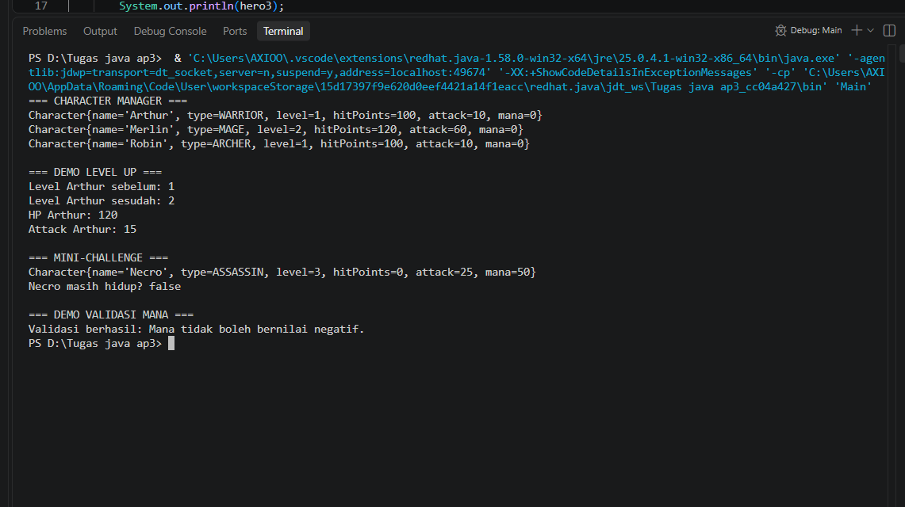

# Character Manager — TP3 (Java Visual SIH-6406)

## Deskripsi

Character Manager adalah program Java sederhana untuk mengelola data karakter menggunakan konsep Object-Oriented Programming (OOP). Program ini menerapkan class, constructor, enum, encapsulation, serta fitur tambahan berupa mana dan pengecekan status hidup karakter.

## Screenshot Output

!(output.png)

## Struktur Folder

```text
CharacterManager/
├── README.md
├── output.png
└── src/
    ├── Main.java
    └── com/
        └── unpri/
            └── charactermanager/
                └── model/
                    ├── Character.java
                    └── CharacterType.java
```

https://docs.google.com/document/d/1KItXMR23LWpFIc2pxm6GX3PtGBmMKYAsuRWfwW_jIm0/edit?usp=sharing