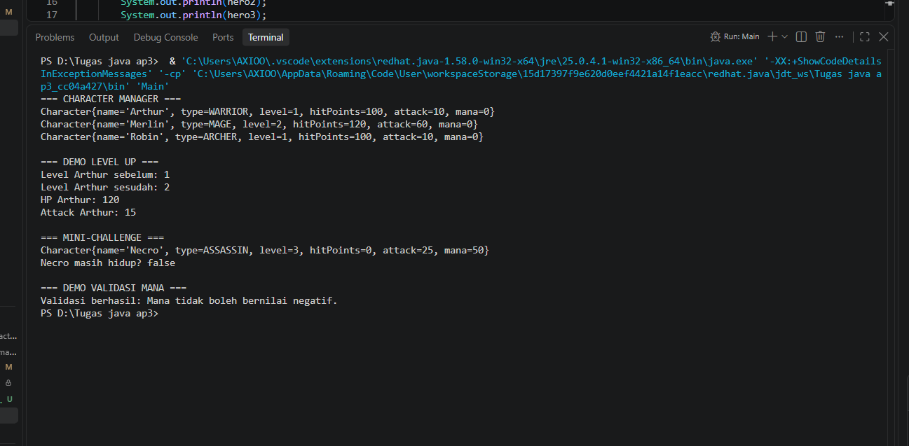
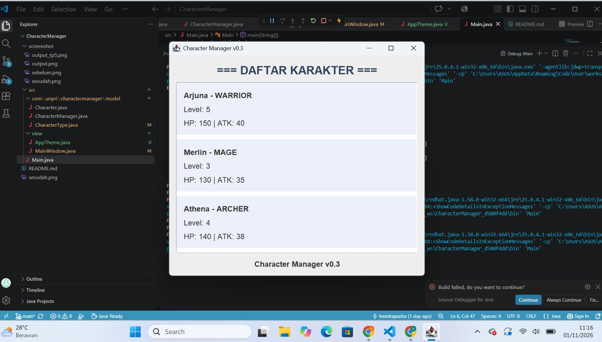
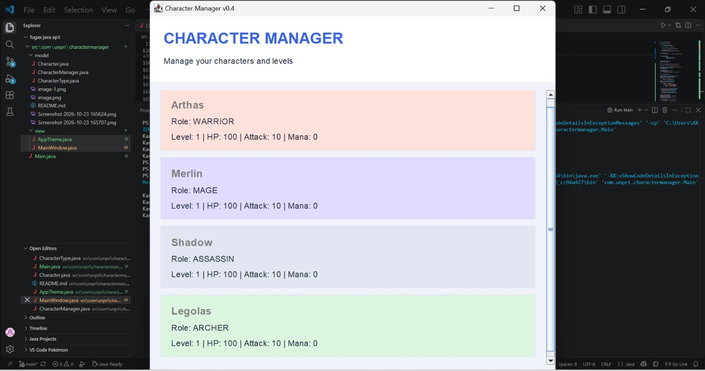

# Character Manager — TP3 (Java Visual SIH-6406)

## Deskripsi

Character Manager adalah program Java sederhana untuk mengelola data karakter menggunakan konsep Object-Oriented Programming (OOP). Program ini menerapkan class, constructor, enum, encapsulation, serta fitur tambahan berupa mana dan pengecekan status hidup karakter.

## Screenshot Output

!(output.png)

## Struktur Folder

```text
CharacterManager/
├── README.md
├── output.png
└── src/
    ├── Main.java
    └── com/
        └── unpri/
            └── charactermanager/
                └── model/
                    ├── Character.java
                    └── CharacterType.java
```

https://docs.google.com/document/d/1KItXMR23LWpFIc2pxm6GX3PtGBmMKYAsuRWfwW_jIm0/edit?usp=sharing


# Java Visual TP5 — CharacterManager

## Identitas Mahasiswa

- Nama: [Nicolia Esraawati Siallagan]
- NIM: 2533033621279
- Kelas: 3 pagi b

## Deskripsi Project

Project ini merupakan pengembangan dari CharacterManager yang dibuat menggunakan bahasa pemrograman Java. Project ini bertujuan untuk mengelola data karakter dengan menerapkan konsep Object-Oriented Programming (OOP), seperti encapsulation, class, object, method, dan reference.

## Fitur Utama

### 1. Character

Class Character digunakan untuk menyimpan data karakter, seperti nama, tipe, level, HP, attack, dan mana.

Method equals() digunakan untuk membandingkan nama karakter. Perbandingan nama dilakukan tanpa membedakan huruf besar dan kecil, sehingga nama "Arthur" dan "arthur" dianggap sama.

### 2. CharacterManager

CharacterManager digunakan untuk mengelola daftar karakter. Method yang tersedia meliputi:

- addCharacter(): menambahkan karakter baru dan menolak nama duplikat.
- findByName(): mencari karakter berdasarkan nama.
- removeCharacter(): menghapus karakter berdasarkan nama.
- getTotalCharacters(): menghitung jumlah karakter.
- getAllCharacters(): mengembalikan salinan daftar karakter.
- getAverageLevel(): menghitung rata-rata level karakter.
- findByType(): mencari karakter berdasarkan tipe.
- findStrongest(): mencari karakter dengan nilai attack tertinggi.

## Mini-Challenge

Method getAverageLevel() menghitung rata-rata level seluruh karakter. Jika daftar karakter kosong, method mengembalikan 0.0 untuk menghindari pembagian dengan nol.

Method findByType() mengembalikan daftar baru yang berisi karakter sesuai tipe yang dipilih.

## Fitur Tambahan: findStrongest()

Fitur tambahan yang saya buat adalah findStrongest(). Method ini digunakan untuk mencari karakter dengan nilai attack tertinggi.

Fitur ini membantu pengguna mengetahui karakter yang memiliki attack paling besar tanpa harus membandingkan nilai attack satu per satu secara manual.

Method ini hanya membaca data karakter dan tidak mengubah daftar internal CharacterManager. Jika daftar karakter kosong, method mengembalikan null karena belum ada karakter yang bisa dipilih.

## Encapsulation dan Defensive Copy

Class CharacterManager menggunakan ArrayList private untuk menyimpan daftar karakter. Daftar tersebut tidak dapat diakses secara langsung dari luar class.

Method getAllCharacters() mengembalikan salinan daftar menggunakan new ArrayList<>(characters). Dengan demikian, penambahan atau penghapusan elemen pada daftar hasil tidak akan mengubah daftar internal CharacterManager.

Namun, salinan ini bersifat shallow copy. Objek Character di dalam daftar hasil masih menggunakan reference ke objek yang sama.

## Hasil Pengujian

Pengujian program dilakukan untuk memeriksa beberapa fitur berikut:

1. Menambahkan karakter baru.
2. Menolak penambahan karakter dengan nama duplikat.
3. Mencari dan menghapus karakter.
4. Menghitung jumlah karakter.
5. Menghitung rata-rata level.
6. Mencari karakter berdasarkan tipe.
7. Mencari karakter dengan attack tertinggi.
8. Menguji defensive copy pada getAllCharacters().
9. Menguji perilaku reference pada objek Character.

### Screenshot Output

## Analisis Reference

Analisis mengenai reference, primitive value, static variable, equals(), dan defensive copy dijelaskan lebih lanjut pada Google Docs berikut:

**Link Google Docs:** https://docs.google.com/document/d/1xOGdtX8e_b4P3pPjKPBP1YwG6WKi52PwaSiJyu9EP0A/edit?usp=sharing

## Kesimpulan

Melalui project ini, saya mempelajari cara mengelola objek menggunakan Java, membandingkan objek berdasarkan data tertentu, menghindari duplikasi nama, serta menjaga data internal menggunakan encapsulation dan defensive copy. Saya juga mempelajari bahwa reference berpengaruh terhadap cara objek diakses dan diubah dalam program Java.


## TP8 — Character Manager GUI dan Analisis MVC

### 1. Implementasi MainWindow

Pada TP8 ini, program Character Manager dikembangkan dari program berbasis console menjadi aplikasi berbasis GUI (Graphical User Interface) menggunakan Java Swing.

Class `MainWindow` menggunakan `JFrame` sebagai jendela utama. Data karakter ditampilkan secara dinamis menggunakan perulangan (`for`), sehingga setiap karakter yang dimasukkan ke dalam `CharacterManager` dapat ditampilkan secara otomatis.

Aplikasi juga memiliki JLabel statistik yang menampilkan rata-rata level seluruh karakter.

### 2. Screenshot Hasil Program

**Screenshot sebelum penambahan data:**


**Screenshot setelah penambahan data:**


Simpan gambar dengan nama `tp8-sesudah.png`.

### 3. Alur Data dan Konsep MVC

Alur kerja program dimulai dari class `Main` yang membuat objek karakter dan memasukkannya ke dalam `CharacterManager`. Selanjutnya, objek `CharacterManager` diberikan kepada `MainWindow` untuk menampilkan seluruh data karakter melalui perulangan. `CharacterManager` berperan sebagai bagian Model karena mengelola data karakter, sedangkan `MainWindow` berperan sebagai View karena menampilkan data kepada pengguna. Dengan demikian, program sudah menerapkan pemisahan antara pengelolaan data dan tampilan, meskipun pada implementasi sederhana ini View masih mengambil data langsung dari Manager.

### 4. Karakter Baru

Karakter yang ditambahkan dalam pengembangan TP8:

| Nama | Tipe | Level | Alasan Pemilihan |
|---|---|---|---|
| Necro | ASSASSIN | Default | Memiliki tipe karakter dengan peran menyerang secara cepat dan menggunakan mana 50. |
| Luna | MAGE | 5 | Dipilih sebagai karakter penyihir dengan level lebih tinggi. |
| Boris | WARRIOR | 4 | Dipilih sebagai karakter petarung dengan level 4 dan HP 180. |

Selain ketiga karakter tersebut, program juga menampilkan Arthur, Merlin, dan Robin sebagai karakter awal.

### 5. Link Analisis GUI dan MVC

Dokumen analisis lengkap Bagian D dapat diakses melalui Google Docs berikut:

**[Masukkan link Google Docs Bagian D di sini]
https://docs.google.com/document/d/1e4WSpcUuLrjbcymYySnkJd_caUBpeygr76uJX331IHs/edit?usp=sharing


# Character Manager – Java Visual Programming

## Informasi Mahasiswa
- **Nama:** [Nama Kamu]
- **NIM:** [NIM Kamu]
- **Kelas:** [Kelas Kamu]
- **Mata Kuliah:** Pemrograman Visual

---

## Deskripsi Project

Character Manager merupakan aplikasi sederhana berbasis Java Swing yang digunakan untuk mengelola karakter dalam sebuah permainan. Aplikasi ini menerapkan konsep Object-Oriented Programming (OOP) dan Model-View-Controller (MVC).

Fitur aplikasi:
- Menampilkan daftar karakter.
- Menampilkan role dan level karakter.
- Menampilkan HP, Attack, dan Mana.
- Menambahkan karakter baru.
- Menghitung total karakter.
- Menghitung rata-rata level karakter.
- Menggunakan tampilan GUI Java Swing.

---

## Struktur Package

Project ini memiliki dua package utama:

- **model:** Menyimpan data karakter, tipe karakter, dan pengelolaan karakter.
- **view:** Menampilkan antarmuka aplikasi menggunakan Java Swing.

---

## TP10 – AppTheme & MainWindow v0.4

### A. Implementasi Tema

Pada TP10 dilakukan pengembangan tampilan aplikasi menggunakan class `AppTheme.java`.

Class AppTheme digunakan untuk mengatur warna, font, dan border agar tampilan aplikasi lebih terstruktur dan konsisten.

Implementasi tema meliputi:
- Warna kartu berdasarkan role karakter.
- Font untuk judul dan informasi karakter.
- Border pada setiap kartu karakter.
- Warna emas untuk karakter dengan level minimal 5.

### B. Screenshot Sebelum dan Sesudah

**1. Sebelum – MainWindow v0.3**

Tampilan aplikasi sebelum menggunakan AppTheme.



**2. Sesudah – MainWindow v0.4**

Tampilan aplikasi setelah menggunakan AppTheme dan penambahan fitur mini-challenge.


### C. Mini-Challenge

Pada mini-challenge, karakter dengan level 5 atau lebih akan memiliki teks berwarna emas dan menggunakan font tebal.

Batas level disimpan dalam konstanta bernama `GOLD_LEVEL_LIMIT` agar lebih mudah diubah dan dikelola.

### D. Properti Tambahan

Dua properti tambahan yang diterapkan:

1. **Tooltip Karakter**

   Tooltip menampilkan informasi HP, Attack, dan Mana ketika kursor diarahkan ke kartu karakter. Fitur ini membantu pengguna melihat informasi karakter dengan lebih mudah.

2. **Karakter Level 1 Dinonaktifkan**

   Karakter yang masih berada di level 1 dibuat berbeda secara visual menggunakan `setEnabled(false)`. Tujuannya untuk membedakan karakter yang masih berada pada level awal.

### E. Pemisahan Tampilan dan Model

Warna, font, dan border disimpan di dalam `AppTheme`, bukan di class `Character`. Hal ini dilakukan agar class Model hanya bertanggung jawab menyimpan dan mengelola data karakter, sedangkan pengaturan tampilan menjadi tanggung jawab View.

Dengan pemisahan ini, tampilan aplikasi dapat diubah tanpa harus mengubah struktur data karakter.

### F. Analisis TP10

Dokumen analisis mengenai JavaBeans, getter dan setter, komponen Swing, pengaturan ukuran komponen, logical font, deriveFont(), serta penerapan prinsip MVC dapat dilihat melalui Google Docs berikut:

**Link Google Docs:** https://docs.google.com/document/d/11kpDhQr3-Aafkd5seRJeqxDzZNPjUQwU1N-SBjd2iWI/edit?usp=sharing

---

## Teknologi yang Digunakan

- Java
- Java Swing
- Visual Studio Code
- JDK
- Git dan GitHub

---

## Kesimpulan

Melalui TP10, saya mempelajari cara mengatur tema aplikasi menggunakan AppTheme dan menerapkannya pada MainWindow. Saya juga memahami pentingnya pemisahan antara Model dan View dalam konsep MVC. Dengan adanya pengaturan tema terpusat, kode tampilan menjadi lebih rapi, konsisten, dan mudah dikembangkan.

---

**Project Character Manager – TP10**