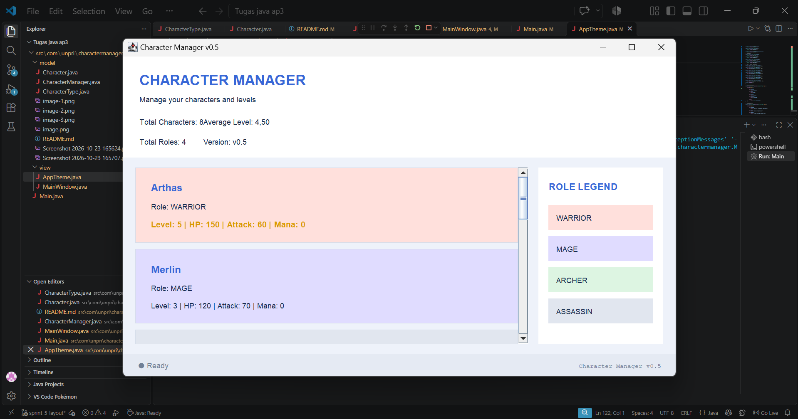
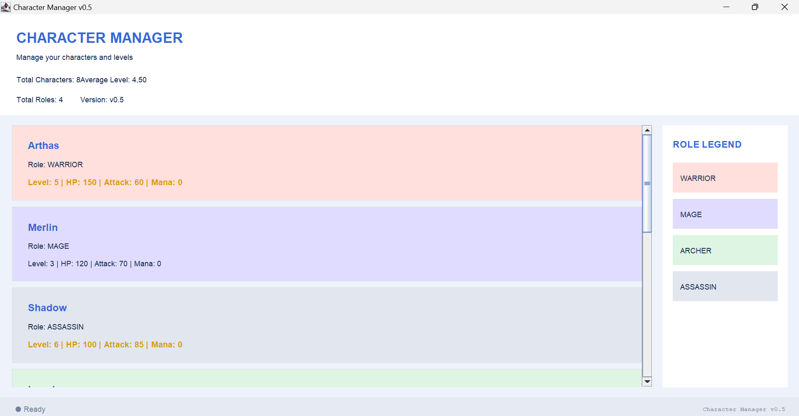
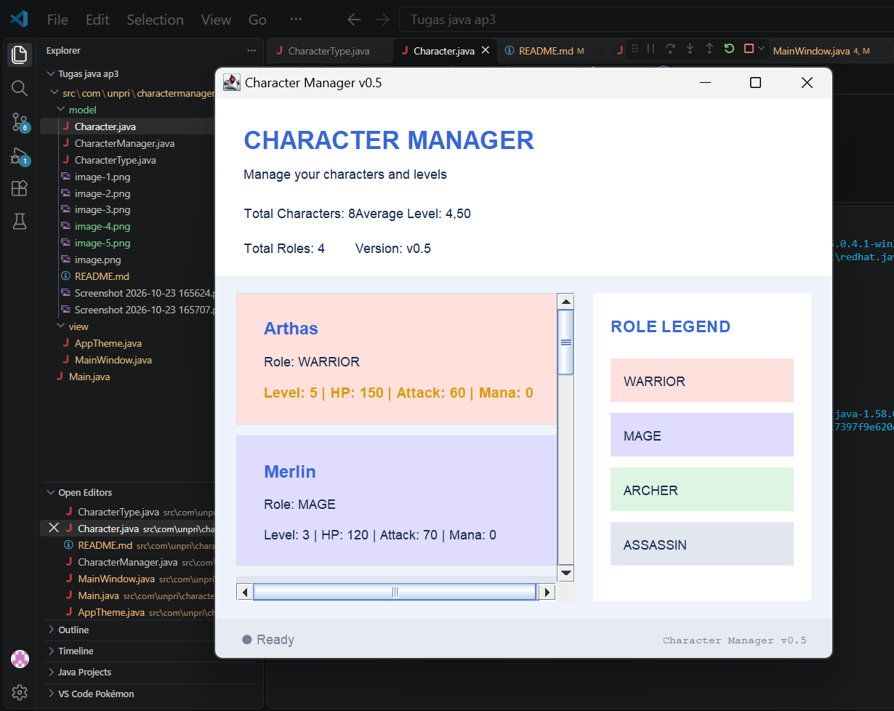

# TP12 – Sprint #5: Dari Satu Kolom ke Layar Berstruktur

## Identitas Mahasiswa
- **Nama:** Nicolia Esrwati Siallagan
- **NIM:** 23303621279
- **Kelas: 3 Pagi B

## Deskripsi Tugas
TP12 merupakan pengembangan aplikasi Character Manager dari versi sebelumnya menjadi versi v0.5. Pada tugas ini, tampilan aplikasi dikembangkan menggunakan beberapa Layout Manager agar lebih terstruktur, rapi, dan dapat menyesuaikan ukuran jendela.

## Tujuan
1. Memahami penggunaan BorderLayout.
2. Mengimplementasikan JScrollPane untuk daftar karakter.
3. Menggunakan GridLayout dan BoxLayout.
4. Memahami pengaruh perubahan ukuran JFrame terhadap komponen.
5. Memisahkan bagian Model dan View sesuai konsep MVC.

## Perubahan File

| File | Perubahan |
|---|---|
| AppTheme.java | Menambahkan BG_STATUS, TEXT_MUTED, dan font monospace |
| MainWindow.java | Mengubah tampilan menjadi v0.5 dengan empat wilayah BorderLayout |
| Main.java | Menambahkan 8 karakter dengan variasi role dan level |

## Implementasi Layout

Aplikasi Character Manager v0.5 menggunakan susunan berikut:

- **NORTH:** Menampilkan header dan informasi statistik karakter.
- **CENTER:** Menampilkan daftar kartu karakter menggunakan JScrollPane.
- **EAST:** Menampilkan legenda role karakter menggunakan BoxLayout.
- **SOUTH:** Menampilkan status aplikasi dan versi v0.5.

### Layout Manager yang Digunakan
1. **BorderLayout:** Membagi tampilan utama menjadi beberapa wilayah.
2. **GridLayout:** Menyusun kartu karakter dan panel statistik.
3. **BoxLayout:** Menyusun legenda role secara vertikal.
4. **JScrollPane:** Memungkinkan daftar karakter digulir ketika ruang tampilan tidak mencukupi.

## Mini-Challenge
Pada tugas ini saya menambahkan:
- Status aplikasi di bagian bawah sebelah kiri.
- Informasi versi aplikasi v0.5 di sebelah kanan.
- Minimal 8 karakter dengan role dan level yang berbeda.
- Panel statistik tambahan menggunakan GridLayout 2x2.
- Tampilan level minimal 5 menggunakan warna emas dan font tebal.

## Struktur Folder

```text
src/
└── com/unpri/charactermanager/
    ├── Main.java
    ├── model/
    │   ├── Character.java
    │   ├── CharacterManager.java
    │   └── CharacterType.java
    └── view/
        ├── AppTheme.java
        └── MainWindow.java
```

## Screenshot Hasil Implementasi

### 1. Tampilan Awal
Screenshot aplikasi ketika pertama kali dijalankan.



### 2. Tampilan Setelah Jendela Diperlebar
Screenshot aplikasi ketika ukuran jendela diperbesar.



### 3. Tampilan Ketika Jendela Diperkecil
Screenshot aplikasi ketika ukuran jendela diperkecil dan scrollbar digunakan.



## Analisis Perubahan Ukuran Jendela

| Kondisi | Prediksi | Hasil |
|---|---|---|
| Jendela diperbesar | Area CENTER bertambah luas | Daftar karakter mendapat ruang lebih besar |
| Jendela diperkecil | Area CENTER menjadi lebih sempit | Scrollbar membantu melihat daftar karakter |
| Ukuran jendela normal | Semua wilayah terlihat | Header, daftar, legenda, dan status bar tampil |

## Alasan Pemilihan Layout

Saya menggunakan BorderLayout karena dapat membagi jendela menjadi beberapa bagian sesuai fungsinya. GridLayout dipilih untuk panel statistik karena dapat menyusun empat informasi secara teratur. BoxLayout digunakan pada legenda role agar setiap role tersusun secara vertikal dan mudah dibaca.

Saya tidak menggunakan FlowLayout untuk panel statistik karena susunan yang dihasilkan tidak membentuk tampilan 2x2 secara konsisten. Dengan kombinasi beberapa Layout Manager, tampilan aplikasi menjadi lebih terstruktur.

## Pemisahan MVC

Pada aplikasi ini, package model digunakan untuk mengelola data karakter, sedangkan package view digunakan untuk mengatur tampilan aplikasi menggunakan Java Swing.

Dengan menerapkan konsep MVC, perubahan tampilan dapat dilakukan tanpa harus mengubah struktur data pada Model.

## Kesimpulan

Melalui TP12 ini, saya memahami cara menggunakan beberapa Layout Manager dalam Java Swing. Saya juga belajar membuat tampilan aplikasi yang dapat menyesuaikan ukuran jendela serta menggunakan JScrollPane untuk menampilkan daftar karakter.

Selain itu, saya memahami pentingnya pemisahan Model dan View agar program lebih terstruktur dan mudah dikembangkan.

## Link Dokumentasi
Google Docs: https://docs.google.com/document/d/1GBHzgEpiXD_ImYjiUwQYhej5cCTAkzlhoFSozl__tug/edit?usp=sharing
